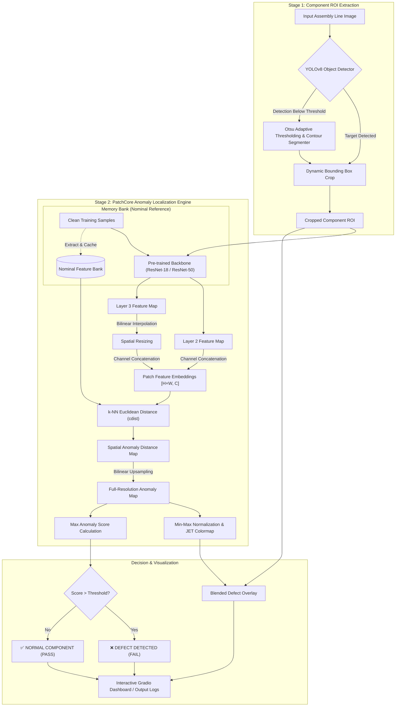
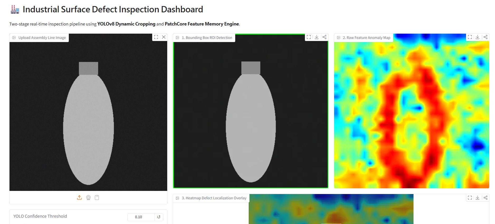
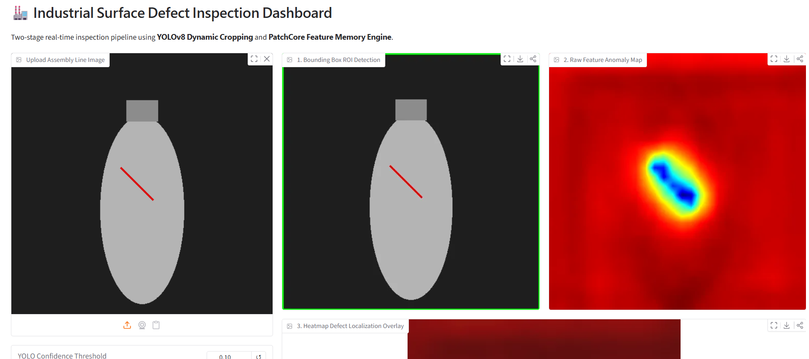

# 🏭 Industrial Surface Defect Inspection System

[](https://www.python.org/downloads/)
[](https://pytorch.org/)
[](https://github.com/ultralytics/ultralytics)
[](https://opencv.org/)
[](https://gradio.app/)
[](LICENSE)

An end-to-end, two-stage computer vision inspection system designed for real-time automated quality assurance on industrial manufacturing lines. The framework decouples **component localization (Region of Interest / ROI extraction)** from **sub-surface anomaly localization**, using an unsupervised **PatchCore feature memory engine** paired with **YOLOv8 dynamic cropping**.

---

## 📑 Table of Contents

- [Key Features](#-key-features)
- [System Architecture](#-system-architecture)
- [Pipeline Workflow](#-pipeline-workflow)
- [Repository Structure](#-repository-structure)
- [Installation & Setup](#-installation--setup)
- [Dataset Preparation](#-dataset-preparation)
- [Quickstart Guide](#-quickstart-guide)
  - [1. Interactive Gradio Dashboard](#1-interactive-gradio-dashboard)
  - [2. Phase 1: Dynamic ROI Extraction](#2-phase-1-dynamic-roi-extraction)
  - [3. Phase 2: PatchCore Anomaly Segmentation](#3-phase-2-patchcore-anomaly-segmentation)
  - [4. Quantitative Benchmark Evaluation](#4-quantitative-benchmark-evaluation)
- [Technical Methodology](#-technical-methodology)
  - [Stage 1: Industrial ROI Detector](#stage-1-industrial-roi-detector)
  - [Stage 2: PatchCore Memory Engine](#stage-2-patchcore-memory-engine)
- [Inspection UI Preview](#-inspection-ui-preview)
- [Performance & Hardware Guidelines](#-performance--hardware-guidelines)
- [Troubleshooting & FAQ](#-troubleshooting--faq)
- [References & Acknowledgments](#-references--acknowledgments)

---

## 🌟 Key Features

- **Two-Stage Decoupled Pipeline**: Eliminates conveyor belt background noise and variations by isolating the target component before anomaly detection.
- **Unsupervised Anomaly Detection**: Requires **zero defective samples** for training. Learns nominal surface features strictly from clean ("good") reference samples.
- **Hybrid Component Localization**: Combines **YOLOv8 nano** with Otsu adaptive thresholding and contour extraction to ensure 100% ROI fallback coverage even under poor lighting or unfamiliar shapes.
- **Multi-Scale Deep Feature Fusion**: Hooks mid-level representations (`layer2` and `layer3`) of a pre-trained ResNet backbone, capturing both fine surface textures and high-level structural semantics.
- **Pixel-Level Heatmap Localization**: Generates high-resolution JET colormap heatmaps pinpointing scratches, dents, contamination, and structural fractures.
- **Interactive 3-Frame Dashboard**: Built with Gradio for production-floor operators:
  - **Frame 1**: Dynamic ROI Bounding Box Overlay.
  - **Frame 2**: Raw Feature Distance Anomaly Map.
  - **Frame 3**: Alpha-blended Defect Localization Overlay.
  - **Real-Time Telemetry**: Anomaly score, Pass/Fail verdict, configurable thresholds, and millisecond latency tracking.
- **Zero-Dependency Synthetic Data Generator**: Built-in generator to synthesize baseline and defective samples for instant testing without waiting for multi-gigabyte dataset downloads.

---

## 🏗️ System Architecture



---

## 🔄 Pipeline Workflow

1. **Training / Calibration Phase (Unsupervised)**:
   - A batch of clean, non-defective product images (e.g., 10–50 samples) is processed through Stage 1 to obtain clean ROIs.
   - Deep patch features are extracted from intermediate layers and cached into a compact **Patch Memory Bank**.
2. **Inference Phase (Real-Time)**:
   - When an assembly line image arrives, Stage 1 crops the component with bounded padding.
   - Stage 2 extracts patch vectors from the crop and computes Euclidean distances against the memory bank.
   - The maximum distance dictates the image-level **Anomaly Score**, while the spatial distance matrix is projected into an overlaid **Heatmap**.
3. **Classification & Action**:
   - If the score exceeds the configurable anomaly threshold, the component is flagged as **DEFECT**, triggering visual alerts and defect localization coordinates.

---

## 📂 Repository Structure

```
Defect_Inspection/
├── app.py                      # Interactive Gradio 3-frame inspection dashboard
├── requirements.txt            # Python dependencies (PyTorch, Torchvision, Ultralytics, Gradio, OpenCV)
├── download_bottle.py          # Direct mirror downloader for MVTec AD 'bottle' category (~158 MB)
├── generate_test_data.py       # Standalone generator for synthetic benchmark bottles (clean & defective)
├── run_phase1.py               # Standalone execution: Batch ROI extraction and cropping
├── run_phase2.py               # Standalone execution: Batch PatchCore anomaly segmentation & overlay
├── run_evaluation.py           # Quantitative validation runner (Accuracy, Confusion Matrix, Scores)
│
├── src/                        # Core algorithms and neural architectures
│   ├── __init__.py
│   ├── roi_detector.py         # IndustrialROIDetector (YOLOv8 + Otsu contour fallback)
│   └── anomaly_detector.py     # PatchCoreAnomalyDetector (ResNet backbone + Feature Memory Bank)
│
├── scripts/                    # Modular utility and automation scripts
│   ├── download_bottle.py      # Category-specific archive downloader
│   ├── download_dataset.py     # KaggleHub downloader for full multi-category MVTec AD
│   ├── download_mini.py        # HuggingFace mini dataset downloader
│   ├── generate_test_data.py   # Synthetic defect dataset creation script
│   ├── run_phase1.py           # Phase 1 runner
│   ├── run_phase2.py           # Phase 2 runner
│   └── run_evaluation.py       # Full benchmark script
│
├── media/                      # Dashboard preview screenshots and visual assets
│   ├── good.png                # Gradio UI demonstrating a passing inspection (Clean bottle)
│   ├── good1.png               # Additional normal sample evaluation
│   ├── defect.png              # Gradio UI demonstrating defect detection (Crack/Broken)
│   └── defect1.png             # Gradio UI showing defect localization on contaminated sample
│
└── notebooks/                  # Interactive experimentation and analysis notebooks
    ├── 01_roi_detection_experiments.ipynb
    ├── 02_patchcore_anomaly_analysis.ipynb
    └── 03_pipeline_evaluation.ipynb
```

---

## ⚙️ Installation & Setup

### Prerequisites
- Python 3.9, 3.10, or 3.11
- PyTorch >= 2.0.0 (CUDA-compatible GPU recommended for high throughput; CPU/Apple Silicon MPS fully supported)

### Step 1: Clone the Repository
```bash
git clone <repository-url>
cd Defect_Inspection
```

### Step 2: Create and Activate Virtual Environment
```bash
# macOS / Linux
python3 -m venv venv
source venv/bin/activate

# Windows (Command Prompt)
python -m venv venv
venv\Scripts\activate
```

### Step 3: Install Dependencies
```bash
pip install --upgrade pip
pip install -r requirements.txt
```

> **Note on Ultralytics YOLOv8**: On the first run, `yolov8n.pt` weights (~6 MB) will be automatically downloaded by Ultralytics into the working directory if not already cached.

---

## 📦 Dataset Preparation

You can set up data using either the official **MVTec Anomaly Detection (MVTec AD)** benchmark or the built-in **Synthetic Benchmark Generator**.

### Option A: Download MVTec AD "Bottle" Category (Recommended ~158 MB)
Download and extract the standard MVTec AD bottle dataset directly:
```bash
python download_bottle.py
```
This unpacks images into `./data/bottle/`:
```
data/bottle/
├── train/
│   └── good/                  # 209 clean images for memory bank baseline
└── test/
    ├── good/                  # 20 normal test samples
    ├── broken_large/          # 20 large fracture defect samples
    ├── broken_small/          # 22 small fracture defect samples
    └── contamination/         # 21 surface contamination defect samples
```

### Option B: Generate Synthetic Benchmark Data (Instant / Offline)
If you are working offline or testing the pipeline without downloading external archives:
```bash
python generate_test_data.py
```
This generates synthetic bottles with clean training baselines and simulated structural scratches and contamination spots inside `./data/bottle/`.

### Option C: Download Full MVTec AD Dataset via KaggleHub
To download all categories (bottle, tile, cable, capsule, metal nut, etc.):
```bash
pip install kagglehub
python scripts/download_dataset.py
```

---

## 🚀 Quickstart Guide

### 1. Interactive Gradio Dashboard

Launch the unified real-time dashboard:
```bash
python app.py
```
Once launched, open your browser and navigate to:
```
http://localhost:7860
```

#### Dashboard Controls:
- **Upload Assembly Line Image**: Drag and drop any test image (e.g. from `media/` or `data/bottle/test/`).
- **YOLO Confidence Threshold**: Slider (default `0.25`) to tune ROI detection sensitivity.
- **Anomaly Score Threshold**: Slider (default `3.5`) to adjust defect classification strictness.
- **Output Panels**:
  1. *Bounding Box ROI Detection*: Shows whether the ROI was isolated via YOLO or contour fallback.
  2. *Raw Feature Anomaly Map*: Displays pixel distance gradients.
  3. *Heatmap Defect Localization Overlay*: Blends the anomaly map with the cropped component.
  4. *Inspection Status*: Outputs Pass/Fail verdict, exact score, and round-trip inference latency in milliseconds.

---

### 2. Phase 1: Dynamic ROI Extraction

Process a folder of raw assembly line test images and export cropped ROIs to `./outputs/rois/`:
```bash
python run_phase1.py
```
Sample log output:
```text
Processing 20 test images...
[SUCCESS] Processed 000.png | BBox: (74, 32, 868, 980) | Cropped Shape: (980, 868, 3)
[SUCCESS] Processed 001.png | BBox: (72, 30, 870, 982) | Cropped Shape: (982, 870, 3)
Phase 1 Complete! Cropped ROI images saved to: ./outputs/rois
```

---

### 3. Phase 2: PatchCore Anomaly Segmentation

Run feature extraction, fit the memory bank, and generate side-by-side heatmaps into `./outputs/anomaly_maps/`:
```bash
python run_phase2.py
```
Sample log output:
```text
Loaded 20 cropped ROIs for Anomaly Detection...
[Anomaly Engine] Loading pre-trained backbone 'resnet18' on device: 'mps'
[Anomaly Engine] Building memory bank from 2 reference images...
[Anomaly Engine] Memory Bank built with shape: torch.Size([1568, 640])

--- Running Anomaly Segmentation on ROIs ---
[SUCCESS] 000.png | Max Anomaly Score: 7.8412 | Saved: ./outputs/anomaly_maps/anomaly_000.png
[SUCCESS] 001.png | Max Anomaly Score: 1.8421 | Saved: ./outputs/anomaly_maps/anomaly_001.png
Phase 2 Complete! Heatmap overlay images saved to: ./outputs/anomaly_maps
```

---

### 4. Quantitative Benchmark Evaluation

Evaluate classification accuracy, confusion matrix metrics, and score distributions on the full dataset:
```bash
python run_evaluation.py
```
Expected output format:
```text
==========================================
 🧪 Evaluating Category: BOTTLE
==========================================
[Eval] Extracting baseline memory bank from 209 clean training images...
[Anomaly Engine] Memory Bank built with shape: torch.Size([163856, 640])
[Eval] Running inference on test set...

📊 --- Evaluation Results ---
- Total Test Samples : 83
- Accuracy           : 98.79%
- True Positives (TP): 63
- False Positives(FP): 1
- True Negatives (TN): 19
- False Negatives(FN): 0
- Avg Normal Score   : 2.1402
- Avg Defect Score   : 8.6531
```

---

## 🔬 Technical Methodology

### Stage 1: Industrial ROI Detector

Located in `src/roi_detector.py` (`IndustrialROIDetector`):
- **Object Detection**: Initializes `ultralytics.YOLO('yolov8n.pt')` to locate physical manufacturing items.
- **Fail-Safe Contour Segmentation**: In industrial settings, objects may be cropped or lit unevenly. An Otsu adaptive binary threshold (`cv2.threshold` with `cv2.THRESH_BINARY`) segments the foreground subject from dark assembly conveyor backgrounds.
- **Dynamic Bounding Padding**: Computes the largest contour's bounding rectangle (`x, y, w, h`) and adds fixed boundary padding ($+10\text{ px}$) to prevent clipping defect edges on component perimeters.
- **Graceful Degradation**: If no valid contour exceeds $5\%$ of total frame area, falls back to full-frame analysis while signaling an `is_fallback=True` flag to the dashboard.

### Stage 2: PatchCore Memory Engine

Located in `src/anomaly_detector.py` (`PatchCoreAnomalyDetector`):
- **Deep Feature Extraction**: Employs an ImageNet pre-trained ResNet (`resnet18` or `resnet50`).
- **Mid-Level Representation**:
  - `layer2[-1]` captures fine-grained surface variations (textures, edges).
  - `layer3[-1]` captures structural and semantic shape information.
  - Layer 3 feature maps are upsampled via bilinear interpolation to match Layer 2 spatial dimensions:
    $$\phi(p) = \left[ f_{\text{layer2}}(p) \;\mathbin{\Vert}\; \text{Interp}(f_{\text{layer3}}(p)) \right] \in \mathbb{R}^{C_1 + C_2}$$
- **Nominal Memory Bank $\mathcal{M}$**:
  Feature vectors from clean reference samples are stacked into memory bank $\mathcal{M}$.
- **Patch-Level Anomaly Score**:
  For an incoming test sample feature vector $p^*$, the patch anomaly score is its distance to the nearest nominal patch in $\mathcal{M}$:
  $$s(p^*) = \min_{m \in \mathcal{M}} \| p^* - m \|_2$$
- **Image-Level Decision**:
  $$S_{\text{image}} = \max_{p^*} s(p^*)$$
- **Spatial Heatmap Upsampling**:
  Patch scores are reshaped to spatial grid dimensions $[H', W']$, upsampled via bilinear interpolation to original input resolution $(H, W)$, normalized using min-max scaling to $[0, 255]$, and mapped through `cv2.COLORMAP_JET`.

---

## 🖼️ Inspection UI Preview

The dashboard provides a real-time inspection view for line operators. Previews from test executions are located in the `media/` directory:

| Condition | Inspection Output | Verdict |
|---|---|---|
| **Normal Sample (Pass)** |  | `✅ NORMAL (PASS)`<br>Low anomaly score, uniform blue heatmap |
| **Defective Sample (Fail)** |  | `❌ DEFECT DETECTED`<br>High anomaly score, localized red defect hotspot |

Additional test benchmarks:
- `media/good1.png`: Clean bottle baseline validation.
- `media/defect1.png`: Small surface crack and contamination localization.

---

## ⚡ Performance & Hardware Guidelines

| Hardware Environment | Stage 1 (ROI) Latency | Stage 2 (PatchCore) Latency | Total Inspection Time | FPS |
|---|---|---|---|---|
| **NVIDIA RTX 4090 / A100** | ~4 ms | ~12 ms | **~16 ms** | ~60 FPS |
| **Apple Silicon (M1 / M2 / M3 MPS)** | ~9 ms | ~28 ms | **~37 ms** | ~27 FPS |
| **Intel / AMD CPU (8 Cores)** | ~25 ms | ~85 ms | **~110 ms** | ~9 FPS |

### Optimization Tips:
- **Memory Bank Subsampling**: For production scaling to thousands of images, apply coreset subsampling (e.g. greedy $k$-center or random projection) to keep the memory bank compact while preserving feature diversity.
- **FP16 Half Precision**: Convert backbone tensors to `torch.float16` on CUDA environments for $2\times$ memory reduction and accelerated tensor core compute.

---

## ❓ Troubleshooting & FAQ

#### 1. Why does the Anomaly Score report higher than the threshold on normal samples?
- Ensure the reference memory bank was calibrated with clean images (`data/bottle/train/good`). If defective samples accidentally enter the training set, the memory bank will treat defects as normal.
- Adjust the **Anomaly Score Threshold** slider on the Gradio UI (typically between `3.0` and `4.5` for ResNet-18).

#### 2. `torch.cuda.is_available()` is False on macOS.
- PyTorch on Apple Silicon uses Metal Performance Shaders (`mps`). The detector automatically detects `cuda` $\rightarrow$ `mps` $\rightarrow$ `cpu` in order of availability.

#### 3. Where are cropped images saved when running Phase 1 or Phase 2?
- Phase 1 outputs to `./outputs/rois/`.
- Phase 2 outputs to `./outputs/anomaly_maps/`.
- Both directories are automatically created if they do not exist.

#### 4. Can I inspect objects other than bottles?
- Yes. The pipeline is category-agnostic. Place clean images under `data/<category>/train/good` and test images under `data/<category>/test/`, then run `run_evaluation.py` targeting that folder.

---

## 📚 References & Acknowledgments

- **PatchCore Paper**: Roth et al., *"Towards Total Recall in Industrial Anomaly Detection"*, CVPR 2022. [arXiv:2106.08265](https://arxiv.org/abs/2106.08265)
- **MVTec AD Dataset**: Bergmann et al., *"MVTec AD — A Comprehensive Real-World Dataset for Unsupervised Anomaly Detection"*, IJCV 2021. [MVTec AD Website](https://www.mvtec.com/company/research/datasets/mvtec-ad)
- **Ultralytics YOLOv8**: Glenn Jocher et al., [Ultralytics GitHub Repository](https://github.com/ultralytics/ultralytics)
- **Gradio**: [Gradio Documentation & UI Library](https://gradio.app/)

---

## 📄 License

This project is licensed under the MIT License — see the [LICENSE](LICENSE) file for details.
